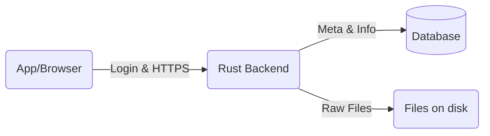
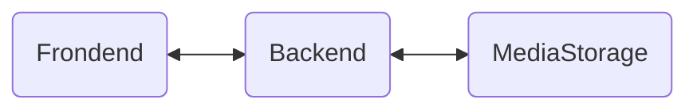
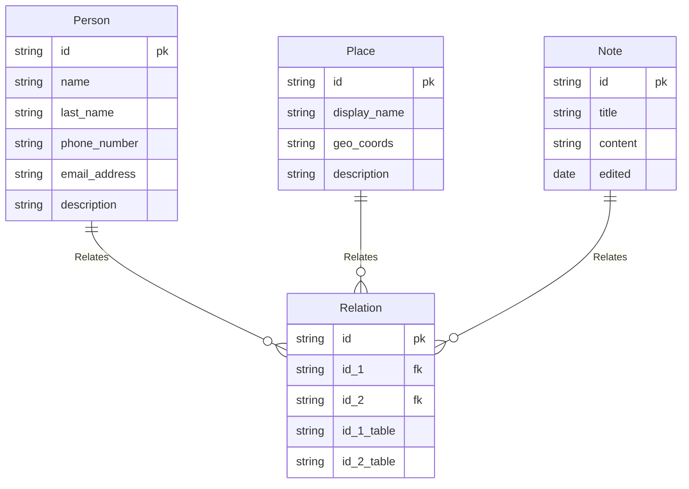

# Fcloud
---
## Personal Cloud 
A private system written in **Rust** for storing being able to access your files easily and safely

---
## Philosophy
### Why?
* I was tired of having my data un organized
* I didnt want to share my data for free with corporation
* A practice, first big project
* I want to be able to query my informations fast

### Architecture

During this time **Frontend** will be written in typical web stack (HTML/CSS/JAVASCRIPT) backend in **Rust** and use **sqlite** for a database.

### Scheme
For first MVP

## How to run
Not yet